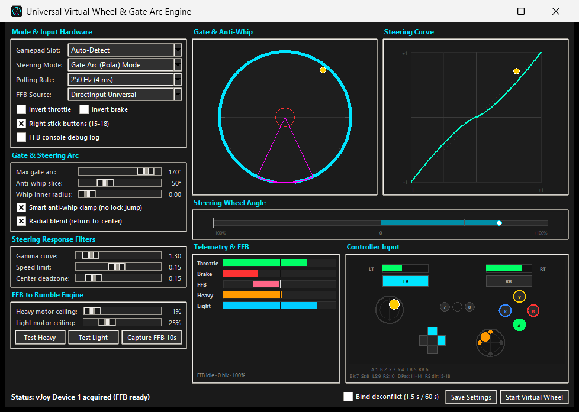
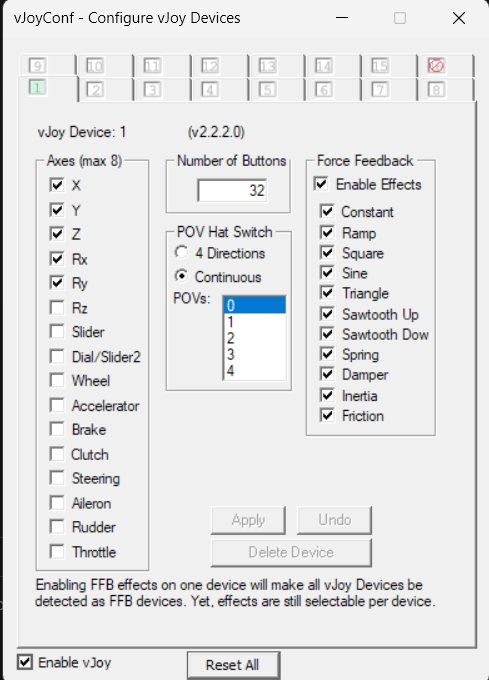

# Virtual Wheel

Virtual Wheel makes an Xbox-style controller work like a steering wheel. It reads
the controller with XInput, feeds a vJoy virtual wheel to the game, and converts
the game's force feedback into rumble on the controller.

Gives you a way better and more intuitive control and feedback.



## Download

Grab `VirtualWheel.exe` from
[Releases](https://github.com/1sad/virtual-wheel/releases/latest). 
Install vJoy from
[BrunnerInnovation vJoy](https://github.com/BrunnerInnovation/vJoy/releases)

## Setting up vJoy

### 1. Install the driver

Download the latest release from
[github.com/BrunnerInnovation/vJoy/releases](https://github.com/BrunnerInnovation/vJoy/releases)
and run the installer. It will ask for administrator rights. Reboot if it asks.

If you already have the old stock vJoy installed, remove it first. Do not install
the stock driver on top of this one.

### 2. Create Device 1

Open `C:\Program Files\vJoy\x64\vJoyConf.exe`, or search for **vJoyConf** in the
Start menu. Select **vJoy Device 1** and set it up like this:



Click **Apply** when you are done. 

You can also do this from a command prompt:

```powershell
& "C:\Program Files\vJoy\x64\vJoyConfig.exe" 1 -f -a X Y Z Rx Ry -b 32 -e all
```

## Start

Default settings should be alright. 

Press "Start Virtual Wheel" at the bottom, and move the stick around 
while looking at the Steering Wheel Angle bar to see what they do.

The status bar at the bottom tells you if vJoy was acquired and whether FFB is
coming in.

The "Bind deconflict" tickbox activates a 1.5 second delay for the outputs,
lets you bind in games that fight for inputs. Lasts 60 seconds then turns off.


## In-depth explanations

### Steering mode

**Gate Arc (Polar) Mode** treats the wheel as if it had a physical gate. The
stick position is converted to an angle, and the wheel can only travel as far as
**Max gate arc** allows. The anti-whip settings shape what happens at the end of
the travel.

**Standard X-Axis Mode** is the simple one. Left and right on the stick becomes
left and right on the wheel, scaled by the deadzone and gamma settings.

### Gate and anti-whip

- **Max gate arc** is how far the virtual wheel turns, in degrees.
- **Anti-whip slice** is the part of the gate at the bottom where the stick is
  being pulled back toward centre, so the wheel can be corrected without
  snapping.
- **Whip inner radius** is the radius inside the gate where the stick is treated
  as centred.
- **Smart anti-whip clamp** stops the anti-whip zone from fighting a real
  counter-steer.
- **Radial blend** blends the return-to-centre behaviour in gradually instead of
  switching it on at the edge.

The gate canvas shows all of this live: the cyan ring is the gate, the purple
wedge is the anti-whip zone, and the orange dot is the stick.

### Steering response

- **Gamma curve** changes how much of the stick travel maps to the first part of
  the wheel range. Above 1 makes small inputs finer.
- **Speed limit** limits how fast the virtual wheel can move per update.
- **Center deadzone** is the area around the stick centre that is ignored.

### FFB to rumble

The game sends force feedback to the vJoy wheel. The app parses those reports and
splits the result into a heavy motor and a light motor.

- **Heavy motor ceiling** and **Light motor ceiling** scale each motor. Keep them
  low to start with, since strong FFB on a small controller gets uncomfortable
  fast.
- **Test Heavy** and **Test Light** pulse each motor so you can check the wiring
  without starting a game.
- **Capture FFB 10s** writes every raw packet to a log file next to
  `settings.ini`. That is what to attach to a bug report if a game's FFB is not
  working.

### FFB source

| Source | When to use it |
|---|---|
| **DirectInput Rich** | Start here. Tracks each effect block, start/stop, duration, start delay, condition effects, periodic effects, ramp, gain and direction. Works with AC1, ACC, LMU. |
| **DirectInput Universal** | Generic fallback. Sums the active X-axis load effects and falls back to periodic effects when there is no load block. |
| **DirectInput Cartesian** | Old signed constant-force passthrough. Kept for testing. |
| **DirectInput Polar** | Old polar-direction sign passthrough. Kept for testing. |
| **Assetto Corsa Shared Memory** | AC1 only. Reads `finalFF` from `Local\acpmf_physics`. Implemented but not tested against a live AC1 session in this release. Do not use it for ACC. |

The vJoy wheel has one force feedback axis. Windows often sends a default polar
direction (usually 90 degrees) even for effects that are really on the X axis, so
the app projects single-axis effects onto X. If both axes are enabled in the
report, the direction is used as sent. Condition effects pick X or Y themselves.

### Window and tray

The window is resizable and sizes itself to fit above the taskbar. It is DPI
aware, so 125% and 150% desktops and RDP sessions lay out correctly.

Refresh rates:

- About 30 FPS while the window is in the foreground.
- 5 FPS after two seconds in the background.
- No drawing at all while minimized or hidden in the tray.

The tray icon is always there. Its menu has **Show Virtual Wheel**, **Hide to
tray**, **Minimize to tray on minimize** (saved in `settings.ini`), and **Exit**.
Closing the window with the X button quits the app.

### Settings

Settings are written to `settings.ini` next to the EXE. If that folder is
read-only, for example when the EXE sits in `Program Files`, the app uses
`%APPDATA%\VirtualWheel\settings.ini` instead. A source run keeps using the
`settings.ini` beside the script.

## Games

| Game | Input | FFB | Notes |
|---|---|---|---|
| Assetto Corsa (AC1) | Works | Works | All five FFB sources work. In testing they felt the same. Use DirectInput Rich. |
| Assetto Corsa Competizione | Works | Likely | Use DirectInput Rich. ACC's shared memory value is not the AC1 field, so the AC1 source does not apply. |
| Le Mans Ultimate | Works | Works | Use DirectInput Rich and set **Use Constant Steering Force Effect = On**. See below. |
| rFactor 2 | Expected | Not tested | Try DirectInput Rich and the same constant force setting as LMU. |
| Automobilista 2 | Expected | Not tested | Use a Generic or Generic Direct Drive wheel profile. During calibration, hold the stick where you want the lock angle when you click Next. |
| PCSX2 / Gran Turismo 4 | Expected | Not tested | Pick a Logitech Driving Force Pro in PCSX2 and point its force feedback at the vJoy device. |

"Input" means the virtual wheel axes and buttons work. "FFB" means rumble was
actually tested in the game.

### LMU and constant steering force

The usual LMU community advice is to set **Use Constant Steering Force Effect =
Off**. This app currently needs it **On**, otherwise LMU's FFB can be silent. It
is a parser limitation, not a tuning problem. If you want to help, set it to Off,
click **Capture FFB 10s** while driving, and attach the log to an issue.

## Known issues

- LMU needs **Use Constant Steering Force Effect = On** in this release.
- The AC1 shared memory source has not been tested with AC1 actually running.
- rFactor 2, AMS2 and PCSX2 / GT4 force feedback are untested.
- All five FFB sources are kept for now. More sim testing is needed before
  removing any of them.
- Resizing the window can feel laggy. The canvases reflow during the drag, but
  they are throttled, so it is not instant on a big window.
- The controller button labels can sit about a pixel off centre at some sizes,
  because Tk rounds the text box and the oval separately.
- Under heavy GPU load the window can redraw in chunks and dragging can stutter.
  That looks like Windows compositing fighting with Tk, not FFB work.
- Restoring a minimized window used to show a black frame. The app repaints on
  map now. If you still see it, open an issue with your GPU and driver version.

## Troubleshooting

- **vJoy Device 1 is busy.** Something else owns the device. Close other vJoy
  clients and restart the app. Only one program can own it at a time.
- **vJoy Device 1 is missing.** Create Device 1 in vJoyConf with the settings
  above.
- **No FFB in LMU.** Set **Use Constant Steering Force Effect = On**.
- **No FFB in another game.** Switch to **DirectInput Rich**, check that the game
  is sending FFB to the vJoy device, and look at the FFB health line for the
  packet rate and active block count.
- **Controller not detected.** The app uses XInput only. Put the controller in
  XInput mode, not DirectInput or PlayStation mode.
- **Settings do not save.** The folder with the EXE is probably read-only. The
  app falls back to `%APPDATA%\VirtualWheel\settings.ini`.
- **No tray icon when running from source.** Install the runtime packages with
  `python -m pip install -r requirements.txt`. The EXE already has them.

## Building from source

You need 64-bit Python 3.15 or newer.

```powershell
python -m pip install -r requirements.txt
python virtual_wheel_vjoy.py
```

To build the EXE:

```powershell
.\build_exe.ps1
```

That installs the pinned build dependencies and writes `dist\VirtualWheel.exe`.
PyInstaller runs with `--onefile --noconsole` and embeds
`assets/virtual_wheel.ico` as the executable icon. The vJoy driver is never
bundled.

The icon is generated from the same gate drawing the app uses for its window and
tray icons:

```powershell
python tools\make_icon.py
```

## License

GPL-3.0. See [LICENSE](LICENSE).
